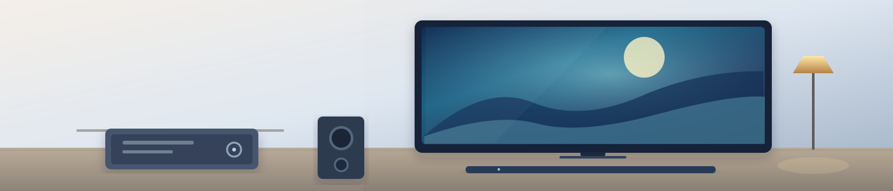

# Robotix Home Intelligence Multimedia UX

Public HACS **Dashboard** package for Multimedia Premium, following the shared RHI UX Core 1.6.4 design grammar and branding used by Energy and Mobility.

**One card:** `custom:homebrain-multimedia-card` with Overview, Rooms, Activities, Devices, Diagnostics. No additional custom cards required.

**Runtime authority:** Multimedia backend `RHI_MULTIMEDIA_EXPERIENCE_V1`, available from RHI Multimedia Integration v0.1.3+. Foundation alone selects source integrations and physical devices per Multimedia concept; Multimedia owns rooms, activities and readback; UX never guesses the physical setup or writes directly to native AV endpoints.

**Install:** See [`docs/HACS_INSTALL.md`](docs/HACS_INSTALL.md). HACS custom repository: `https://github.com/npinguin/rhi-multimedia-ux` (**Dashboard**). Resource `/hacsfiles/rhi-multimedia-ux/rhi-multimedia-ux.js` (HACS manages it). Do not register legacy/duplicate bundles.

**Development:** `npm ci && npm run build && npm test`. `src/` is authoritative, `dist/` is generated and **committed**; validation checks `dist/` against its source bytes. Exactly three workflows: Validate, Publish HACS and Release. PR validates full UX and HACS, publishing creates a normal immutable GitHub TEST CANDIDATE release **without release assets**, so HACS installs the complete tagged `dist/` tree including hero SVG. Runtime qualification on physical Home Assistant and rollback is mandatory for stable promotion.

**Shared ownership:** [`rhi-ux-core`](https://github.com/npinguin/rhi-ux-core) owns company logo and visual primitives; Multimedia UX only adds its own media-specific hero and screens. See [`docs/CONTRACT.md`](docs/CONTRACT.md).
